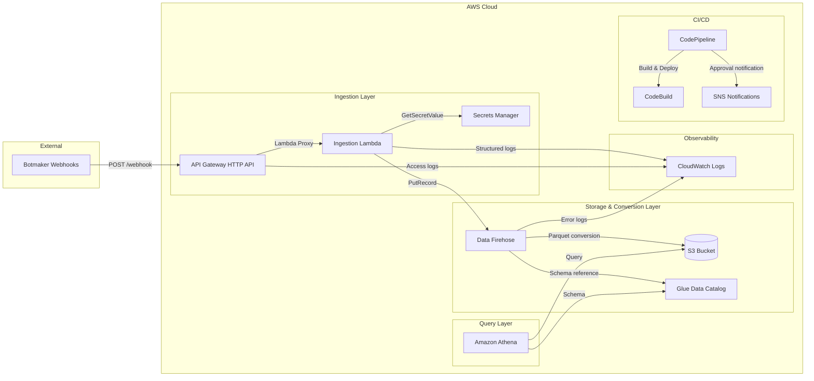
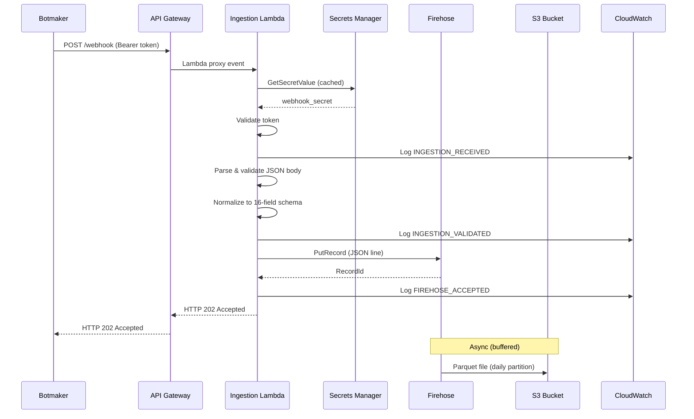

# Design Document: Botmaker Log Ingestion Pipeline

## Overview

This document describes the technical design for a serverless log ingestion pipeline that captures Botmaker webhook events, normalizes them into a stable 16-field schema, converts them to Apache Parquet via Amazon Data Firehose, and stores them in S3 with daily partitions queryable via Amazon Athena. The system is built entirely on AWS serverless services, deployed via AWS SAM/CloudFormation, and automated through an 8-stage CodePipeline CI/CD process.

### Key Design Decisions

1. **API Gateway HTTP API over REST API**: HTTP API offers lower latency, lower cost, and native Lambda proxy integration suitable for this webhook ingestion pattern.
2. **Firehose Direct PUT over Kinesis Data Streams**: Since the Lambda already performs normalization, there's no need for an intermediate stream. Firehose Direct PUT simplifies the architecture and handles Parquet conversion natively.
3. **Partition Projection over Glue Crawler**: Eliminates the operational overhead of a crawler while providing instant partition availability for Athena queries.
4. **Python with Hypothesis for PBT**: Python is the Lambda runtime; Hypothesis provides mature property-based testing to verify normalization correctness across arbitrary webhook payloads.
5. **Separate CI/CD stack**: The pipeline infrastructure is decoupled from the application stack, enabling independent lifecycle management and avoiding circular dependencies.

## Architecture

### High-Level Architecture Diagram



### Request Flow Sequence



## Components and Interfaces

### 1. API Gateway HTTP API

| Attribute | Value |
|-----------|-------|
| Protocol | HTTP/2 with TLS 1.2+ |
| Route | POST /webhook |
| Integration | Lambda proxy (payload format 2.0) |
| Throttling | 1000 concurrent executions (Lambda reserved) |
| Access Logging | Enabled, 30-day retention |

**Interface**: Receives raw HTTP POST requests from Botmaker, passes the full event (headers, body, path, method) to the Lambda function.

### 2. Ingestion Lambda

| Attribute | Value |
|-----------|-------|
| Runtime | Python 3.12 |
| Memory | 256 MB |
| Timeout | 10 seconds |
| Reserved Concurrency | 1000 |
| Architecture | arm64 (Graviton2) |

**Responsibilities**:
- Bearer token authentication via Secrets Manager
- Request validation (JSON parsing, size checks)
- Event normalization (16-field schema extraction)
- Firehose PutRecord delivery
- Structured logging with correlation IDs

**Internal Modules**:

```
src/
├── handler.py          # Lambda entry point, request routing
├── auth.py             # Token validation, secret caching
├── normalizer.py       # Field extraction, schema normalization
├── firehose_client.py  # PutRecord wrapper with error handling
├── logger.py           # Structured JSON logging with redaction
└── config.py           # Environment-based configuration
```

### 3. Secrets Manager

| Attribute | Value |
|-----------|-------|
| Secret Name | `{project}/{environment}/webhook-secret` |
| Caching | In-memory with 5-minute TTL |
| Timeout | 5 seconds |

**Interface**: The Lambda retrieves the webhook Bearer token at startup (cold start) and caches it in-memory for subsequent invocations. On cache miss or expiry, it re-fetches from Secrets Manager.

### 4. Amazon Data Firehose

| Attribute | Value |
|-----------|-------|
| Source | Direct PUT |
| Destination | Extended S3 |
| Format Conversion | JSON → Parquet (Snappy) |
| Input Deserializer | OpenX JSON SerDe |
| Output Serializer | Parquet (Snappy compression) |
| Buffer Size | 64 MB (configurable, min 64 when conversion enabled) |
| Buffer Interval | 300 seconds (configurable, 60-900) |
| Encryption | Server-side (SSE-S3 or SSE-KMS) |
| Error Logging | CloudWatch enabled |

**S3 Prefixes**:
- Success: `data/ingestion_date=!{timestamp:yyyy-MM-dd}/`
- Errors: `firehose-errors/type=!{firehose:error-output-type}/ingestion_date=!{timestamp:yyyy-MM-dd}/`

**Custom Timezone**: `America/Bogota` (UTC-5) for partition date computation.

### 5. Glue Data Catalog

| Attribute | Value |
|-----------|-------|
| Database | `{project_name}_{environment}` |
| Table | `botmaker_logs` |
| SerDe | `org.apache.hadoop.hive.ql.io.parquet.serde.ParquetHiveSerDe` |
| Input Format | `org.apache.hadoop.hive.ql.io.parquet.MapredParquetInputFormat` |
| Output Format | `org.apache.hadoop.hive.ql.io.parquet.MapredParquetOutputFormat` |
| Partition Projection | Enabled (date type, 1-day interval) |

### 6. Amazon Athena WorkGroup

| Attribute | Value |
|-----------|-------|
| Results Location | `s3://{bucket}/athena-results/` |
| Encryption | SSE-S3 or SSE-KMS |
| Metrics | CloudWatch publishing enabled |
| Enforcement | WorkGroup settings override queries |
| Conditional | Created only when `EnableAthenaWorkGroup=true` |

### 7. S3 Bucket

| Attribute | Value |
|-----------|-------|
| Encryption | SSE-S3 (default) or SSE-KMS |
| Public Access | All four block settings enabled |
| Bucket Policy | Deny non-TLS (aws:SecureTransport=false) |
| Lifecycle | Configurable retention |

### 8. CI/CD Pipeline (CodePipeline)

| Stage | Action | BuildSpec |
|-------|--------|-----------|
| Source | CodeConnections (GitHub) | — |
| ValidateAndTest | CodeBuild | buildspec-ci.yml |
| Package | CodeBuild | buildspec-package.yml |
| DeployDev | CloudFormation Deploy | — |
| IntegrationTests | CodeBuild | buildspec-integration.yml |
| ManualApproval | Manual (7-day timeout) | — |
| DeployProd | CloudFormation Deploy | — |
| SmokeTestProd | CodeBuild | buildspec-smoke.yml |

## Data Models

### Normalized Record Schema (16 fields)

| # | Field Name | Type | Required | Source/Logic |
|---|-----------|------|----------|--------------|
| 1 | ingestion_id | string | Yes | Generated UUID v4 per event |
| 2 | event_id | string | Yes | Fallback chain: eventId → errorId → linkId → messageId → conversation.messageId → generated UUID v4 |
| 3 | request_id | string | No | API Gateway request ID from Lambda context |
| 4 | received_at | string | Yes | ISO-8601 UTC with ms precision (e.g., `2024-01-15T09:30:00.123Z`) |
| 5 | schema_version | int | Yes | Always `1` |
| 6 | environment | string | Yes | From Lambda environment variable |
| 7 | event_type | string | Yes | Fallback chain: eventType → error.type → type → PAYMENT_LINK_EVENT (if paymentLink key) → ORDER_EVENT (if orders key) → UNKNOWN |
| 8 | conversation_id | string | No | conversation.conversationId |
| 9 | message_id | string | No | Fallback: messageId → conversation.messageId |
| 10 | user_id | string | No | conversation.userId |
| 11 | order_form_id | string | No | Fallback: orderForm.id → context.orderFormId |
| 12 | source_channel | string | No | source.channel |
| 13 | source_bot | string | No | source.bot |
| 14 | severity | string | No | error.severity |
| 15 | error_code | string | No | error.code |
| 16 | raw_event_json | string | Yes | Complete original JSON: `json.dumps(body, ensure_ascii=False, separators=(",", ":"))` |

### Parquet Schema (Glue Table Columns)

```
ingestion_id:     string    (NOT NULL)
event_id:         string    (NOT NULL)
request_id:       string    (NULLABLE)
received_at:      string    (NOT NULL)
schema_version:   int       (NOT NULL)
environment:      string    (NOT NULL)
event_type:       string    (NOT NULL)
conversation_id:  string    (NULLABLE)
message_id:       string    (NULLABLE)
user_id:          string    (NULLABLE)
order_form_id:    string    (NULLABLE)
source_channel:   string    (NULLABLE)
source_bot:       string    (NULLABLE)
severity:         string    (NULLABLE)
error_code:       string    (NULLABLE)
raw_event_json:   string    (NOT NULL)
ingestion_date:   string    (PARTITION KEY, format: yyyy-MM-dd)
```

### Field Extraction Logic (Pseudocode)

```python
def extract_event_id(body: dict) -> str:
    chain = ["eventId", "errorId", "linkId", "messageId"]
    for key in chain:
        val = body.get(key)
        if val and isinstance(val, str) and val.strip():
            return val
    # Nested fallback
    conv_msg = get_nested(body, "conversation", "messageId")
    if conv_msg and isinstance(conv_msg, str) and conv_msg.strip():
        return conv_msg
    return str(uuid4())

def extract_event_type(body: dict) -> str:
    if body.get("eventType"):
        return body["eventType"]
    if get_nested(body, "error", "type"):
        return get_nested(body, "error", "type")
    if body.get("type"):
        return body["type"]
    if "paymentLink" in body:
        return "PAYMENT_LINK_EVENT"
    if "orders" in body:
        return "ORDER_EVENT"
    return "UNKNOWN"

def get_nested(body: dict, *keys) -> Optional[str]:
    """Traverse dot-notation path safely."""
    current = body
    for key in keys:
        if not isinstance(current, dict):
            return None
        current = current.get(key)
        if current is None:
            return None
    if isinstance(current, str) and current.strip():
        return current
    return None
```

### API Request/Response Contracts

**Successful Ingestion (202)**:
```json
// Request
POST /webhook
Authorization: Bearer <token>
Content-Type: application/json

{"eventId": "abc-123", "eventType": "MESSAGE_RECEIVED", ...}

// Response
HTTP/1.1 202 Accepted
Content-Type: application/json

{"status": "accepted", "ingestion_id": "uuid-v4-value"}
```

**Authentication Failure (401)**:
```json
HTTP/1.1 401 Unauthorized
Content-Type: application/json

{"error": "Unauthorized", "message": "Invalid or missing authentication token"}
```

**Invalid JSON (400)**:
```json
HTTP/1.1 400 Bad Request
Content-Type: application/json

{"error": "Bad Request", "message": "Payload is not parseable JSON"}
```

**Payload Too Large (413)**:
```json
HTTP/1.1 413 Payload Too Large
Content-Type: application/json

{"error": "Payload Too Large", "message": "Request body exceeds maximum allowed size"}
```

**Firehose Unavailable (503)**:
```json
HTTP/1.1 503 Service Unavailable
Content-Type: application/json

{"error": "Service Unavailable", "message": "Unable to deliver record to storage"}
```

### Structured Log Entry Format

```json
{
  "timestamp": "2024-01-15T09:30:00.123Z",
  "level": "INFO",
  "correlation_id": "req-uuid-from-apigw",
  "event_type": "INGESTION_VALIDATED",
  "outcome": "success",
  "ingestion_id": "generated-uuid-v4",
  "source_event_type": "MESSAGE_RECEIVED",
  "duration_ms": 15
}
```

### CloudFormation Parameters

| Parameter | Type | Default | Constraints |
|-----------|------|---------|-------------|
| FirehoseBufferIntervalSeconds | Number | 300 | Min 60, Max 900 |
| FirehoseBufferSizeMB | Number | 64 | Min 64, Max 128 |
| PartitionProjectionStartDate | String | 2026-01-01 | yyyy-MM-dd format |
| ParquetCompression | String | SNAPPY | SNAPPY, GZIP, UNCOMPRESSED |
| AthenaBytesScannedCutoffPerQuery | Number | — | Bytes |
| AthenaResultsRetentionDays | Number | 30 | Positive integer |
| EnableAthenaWorkGroup | String | true | true, false |


## Correctness Properties

*A property is a characteristic or behavior that should hold true across all valid executions of a system—essentially, a formal statement about what the system should do. Properties serve as the bridge between human-readable specifications and machine-verifiable correctness guarantees.*

### Property 1: Normalization Invariant (16-field structure)

*For any* valid webhook JSON object that passes authentication and validation, the Ingestion_Lambda normalization SHALL produce a record with exactly 16 keys matching the defined field names in snake_case, where ingestion_id is a valid UUID v4, received_at matches ISO-8601 UTC with millisecond precision, schema_version equals the integer 1, and all 7 required fields (ingestion_id, event_id, received_at, schema_version, environment, event_type, raw_event_json) are non-null.

**Validates: Requirements 2.1, 2.2, 2.3, 2.4, 2.5, 2.6**

### Property 2: Fallback Chain Priority

*For any* valid webhook JSON object containing multiple candidate values for a fallback-chain field (event_id, event_type, message_id, order_form_id), the Ingestion_Lambda extraction SHALL return the value from the highest-priority non-null, non-empty-string source in the defined chain, ignoring lower-priority candidates.

**Validates: Requirements 3.1, 3.2, 3.4, 3.6**

### Property 3: Path Traversal Null Safety

*For any* valid webhook JSON object where a dot-notation field path has an absent key, a null intermediate, a non-object intermediate, or resolves to an empty string, the Ingestion_Lambda SHALL store null for that field in the Normalized_Record.

**Validates: Requirements 3.3, 3.5, 3.7, 3.8, 3.9, 3.10, 3.11, 3.12, 3.13**

### Property 4: Raw Event JSON Round-Trip

*For any* valid webhook JSON object, the raw_event_json field in the Normalized_Record SHALL satisfy: `json.loads(normalized_record["raw_event_json"]) == original_body`, ensuring lossless preservation of the original event data.

**Validates: Requirements 4.2**

### Property 5: Base64 Decoding Equivalence

*For any* valid webhook JSON object, processing it with `isBase64Encoded=True` and a base64-encoded body SHALL produce an identical Normalized_Record (excluding received_at and ingestion_id which are generated fresh) as processing the same JSON directly with `isBase64Encoded=False`.

**Validates: Requirements 4.1**

### Property 6: Non-Object JSON Rejection

*For any* valid JSON value that is NOT a JSON object (arrays, strings, numbers, booleans, null), the Ingestion_Lambda SHALL reject the request with HTTP 400 and SHALL NOT produce a Normalized_Record.

**Validates: Requirements 4.3**

### Property 7: Invalid Authentication Rejection

*For any* string that does not exactly match the configured webhook secret, the Ingestion_Lambda SHALL return HTTP 401 Unauthorized and the response body SHALL NOT contain the expected secret value or any credential information.

**Validates: Requirements 1.3**

### Property 8: Missing Required Field Rejection

*For any* valid webhook JSON object that is missing one or more of the required source fields (where environment comes from config and event_type/event_id cannot be derived from any fallback), the Ingestion_Lambda SHALL reject the event and return an error identifying the missing field.

**Validates: Requirements 2.7**

### Property 9: Log Redaction Safety

*For any* request processed by the Ingestion_Lambda where the request contains authentication tokens or secret values, no log entry emitted during processing SHALL contain the literal token value, API key, or secret string.

**Validates: Requirements 9.4, 16.2**

### Property 10: Parquet Schema Round-Trip

*For any* valid Normalized_Record produced by the Ingestion_Lambda, writing the record to a Parquet file using the Glue Catalog schema and reading it back SHALL preserve all field values identically, including null values for optional absent fields.

**Validates: Requirements 11.4**

## Error Handling

### Error Categories and Responses

| Error Condition | HTTP Status | Response | Logging |
|----------------|-------------|----------|---------|
| Missing/invalid Bearer token | 401 | `{"error": "Unauthorized"}` | INGESTION_RECEIVED with outcome=failure, source IP logged |
| Non-JSON body | 400 | `{"error": "Bad Request", "message": "...not parseable JSON"}` | INGESTION_RECEIVED with outcome=failure |
| Non-object JSON (array, primitive) | 400 | `{"error": "Bad Request", "message": "...not a valid JSON object"}` | INGESTION_RECEIVED with outcome=failure |
| Body exceeds 1 MB after decoding | 400 | `{"error": "Bad Request", "message": "...exceeds maximum size"}` | INGESTION_RECEIVED with outcome=failure |
| Body exceeds 6 MB (pre-decode) | 413 | `{"error": "Payload Too Large"}` | INGESTION_RECEIVED with outcome=failure |
| Missing required source fields | 400 | `{"error": "Bad Request", "message": "Missing field: <name>"}` | INGESTION_VALIDATED with outcome=failure |
| Secrets Manager timeout (>5s) | 500 | `{"error": "Internal Server Error"}` | Error with retrieval failure (no secret exposed) |
| Firehose PutRecord failure | 503 | `{"error": "Service Unavailable"}` | FIREHOSE_ACCEPTED with outcome=failure |
| Undefined route | 404 | API Gateway default | Access log |
| Unsupported method | 405 | API Gateway default | Access log |
| Throttled (>1000 concurrent) | 429 | API Gateway default | Access log |

### Error Handling Strategy

1. **Fail Fast**: Validation errors are detected early (auth → JSON parse → type check → size check → field validation) to minimize processing of invalid requests.

2. **Retry Semantics**: The Lambda does NOT retry Firehose PutRecord beyond the boto3 SDK's built-in retries (adaptive retry mode with max 3 attempts). If all retries fail, 503 is returned and the caller (Botmaker) should retry.

3. **Secret Retrieval Failure**: If Secrets Manager cannot be reached within 5 seconds, the Lambda returns an opaque error (no secret name/value exposed) and logs the failure type.

4. **Correlation Through Errors**: Every error response maintains the correlation ID in logs so that failed requests can be traced end-to-end.

5. **Firehose Delivery Errors**: Format conversion errors are written to the error prefix (`firehose-errors/`) and logged to CloudWatch. These don't affect the Lambda (which already returned 202) but are monitored via CloudWatch alarms.

### Secret Caching Strategy

```python
class SecretCache:
    """In-memory cache with TTL for Secrets Manager values."""
    
    def __init__(self, ttl_seconds: int = 300):
        self._value: Optional[str] = None
        self._expires_at: float = 0
        self._ttl = ttl_seconds
    
    def get(self, secret_id: str, client) -> str:
        if self._value and time.time() < self._expires_at:
            return self._value
        response = client.get_secret_value(SecretId=secret_id)
        self._value = response["SecretString"]
        self._expires_at = time.time() + self._ttl
        return self._value
```

## Testing Strategy

### Testing Pyramid

```
┌─────────────────────────────────┐
│    Smoke Tests (Prod)           │  ← Post-deploy health check
├─────────────────────────────────┤
│    Integration Tests (Dev)      │  ← End-to-end against deployed stack
├─────────────────────────────────┤
│    Infrastructure Tests         │  ← cfn-lint, sam validate, policy checks
├─────────────────────────────────┤
│    Schema Validation Tests      │  ← PyArrow Parquet round-trip
├─────────────────────────────────┤
│    Property-Based Tests         │  ← Hypothesis (100+ examples)
├─────────────────────────────────┤
│    Unit Tests                   │  ← pytest, mocks, 85%+ coverage
└─────────────────────────────────┘
```

### Unit Tests (pytest + mocks)

- **Coverage Target**: ≥85% of `src/` directory
- **Framework**: pytest with pytest-cov
- **Mocking**: unittest.mock for boto3 clients (Firehose, Secrets Manager)
- **Categories**:
  - Authentication logic (valid/invalid/missing/malformed tokens, SM errors, caching)
  - Request parsing (valid JSON, invalid JSON, empty, array, primitive, base64, oversized, Unicode)
  - Normalization (all 16 fields, all extraction chains, edge cases)
  - JSON preservation (compact serialization, ensure_ascii=False)
  - Firehose interaction (success, unavailable, timeout, permission errors)
  - Logging redaction (no tokens, recursive redaction, LOG_PAYLOAD modes)

### Property-Based Tests (Hypothesis)

- **Library**: Hypothesis for Python
- **Minimum Iterations**: 100 examples per property
- **Tag Format**: `# Feature: botmaker-log-ingestion, Property {N}: {title}`
- **Properties to Implement**:

| Property | Test File | Key Strategy |
|----------|-----------|--------------|
| P1: Normalization Invariant | `tests/test_normalizer_properties.py` | Generate arbitrary JSON objects, verify 16-field structure |
| P2: Fallback Chain Priority | `tests/test_normalizer_properties.py` | Generate objects with multiple fallback candidates, verify priority |
| P3: Path Traversal Null Safety | `tests/test_normalizer_properties.py` | Generate objects with broken paths (null intermediates, non-dict), verify null |
| P4: Raw Event JSON Round-Trip | `tests/test_normalizer_properties.py` | Generate arbitrary JSON objects, verify json.loads(raw_event_json) == original |
| P5: Base64 Decoding Equivalence | `tests/test_handler_properties.py` | Generate JSON, process both raw and base64-encoded, verify equivalence |
| P6: Non-Object JSON Rejection | `tests/test_handler_properties.py` | Generate non-object JSON values (arrays, strings, numbers), verify 400 |
| P7: Invalid Auth Rejection | `tests/test_auth_properties.py` | Generate arbitrary strings ≠ secret, verify 401 |
| P8: Missing Required Field Rejection | `tests/test_normalizer_properties.py` | Generate objects missing event_type when no fallbacks exist, verify rejection |
| P9: Log Redaction Safety | `tests/test_logger_properties.py` | Generate payloads with token strings, verify token never appears in logs |
| P10: Parquet Schema Round-Trip | `tests/test_schema_properties.py` | Generate normalized records, write/read Parquet, verify field-by-field equality |

### Hypothesis Generator Strategy

```python
from hypothesis import strategies as st

# Strategy for arbitrary webhook JSON objects
webhook_payloads = st.fixed_dictionaries({}, optional={
    "eventId": st.text(min_size=1, max_size=64),
    "errorId": st.text(min_size=1, max_size=64),
    "linkId": st.text(min_size=1, max_size=64),
    "messageId": st.text(min_size=1, max_size=64),
    "eventType": st.text(min_size=1, max_size=64),
    "type": st.text(min_size=1, max_size=64),
    "paymentLink": st.fixed_dictionaries({}),
    "orders": st.lists(st.fixed_dictionaries({})),
    "conversation": st.fixed_dictionaries({}, optional={
        "conversationId": st.text(max_size=64),
        "messageId": st.text(max_size=64),
        "userId": st.text(max_size=64),
    }),
    "source": st.fixed_dictionaries({}, optional={
        "channel": st.text(max_size=32),
        "bot": st.text(max_size=32),
    }),
    "error": st.fixed_dictionaries({}, optional={
        "type": st.text(max_size=32),
        "severity": st.text(max_size=16),
        "code": st.text(max_size=32),
    }),
    "orderForm": st.fixed_dictionaries({}, optional={
        "id": st.text(max_size=64),
    }),
    "context": st.fixed_dictionaries({}, optional={
        "orderFormId": st.text(max_size=64),
    }),
})
```

### Schema Validation Tests (PyArrow)

- **Dependency**: PyArrow (dev-only, not in Lambda runtime)
- **Tests**:
  - Verify 16+1 columns match Glue table definition types
  - Write Parquet file, read back, assert schema and values match
  - Test all-null optional fields record
  - Test all-populated fields record
  - Property test: round-trip for any generated Normalized_Record

### Infrastructure Validation Tests

- **Tools**: sam validate --lint, cfn-lint
- **Policy Checks**:
  - S3 public access block (all 4 settings true)
  - S3 and Firehose encryption enabled
  - S3 bucket policy denies non-TLS
  - No wildcard IAM actions or resources
  - Firehose DataFormatConversionConfiguration enabled

### Integration Tests (deployed dev stack)

- **Target**: Live API endpoint from CloudFormation outputs
- **Scenarios**: 202, 401, 400, 413, 404/405
- **Verification Chain**:
  1. HTTP response validation
  2. CloudWatch Logs verification (60s poll)
  3. S3 Parquet file verification (330s wait for buffer flush)
  4. Athena query verification (60s query wait)
- **Isolation**: Unique ingestion_id per test run

### Smoke Tests (production)

- **Trigger**: Post-deployment in CodePipeline
- **Event**: `event_type=PIPELINE_SMOKE_TEST`
- **Verification**: FIREHOSE_ACCEPTED in CloudWatch within 30 seconds
- **Filtering**: Downstream consumers exclude PIPELINE_SMOKE_TEST events

### Test Execution Commands

```bash
# Unit + Property tests
pytest tests/unit/ tests/properties/ --cov=src --cov-report=xml -v

# Infrastructure tests
pytest tests/infra/ -v

# Schema tests
pytest tests/schema/ -v

# Integration tests (requires deployed dev stack)
pytest tests/integration/ -v --stack-name=<dev-stack>

# Smoke tests (requires deployed prod stack)
pytest tests/smoke/ -v --stack-name=<prod-stack>
```

### CI BuildSpec Summary

| BuildSpec | Purpose | Tests Run |
|-----------|---------|-----------|
| buildspec-ci.yml | Validate & test | sam validate, cfn-lint, unit, property, schema, infra tests |
| buildspec-package.yml | SAM package | sam build, sam package |
| buildspec-integration.yml | Integration | Integration test suite against dev stack |
| buildspec-smoke.yml | Smoke | Smoke test suite against prod stack |
