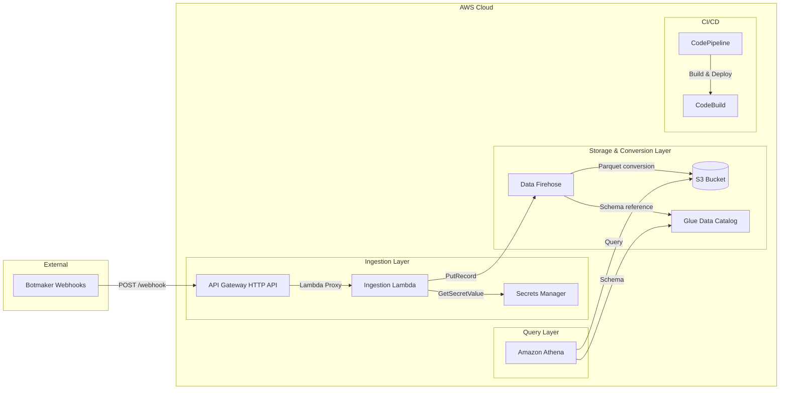

# Botmaker Log Ingestion Pipeline

A serverless log ingestion pipeline that captures Botmaker webhook events, normalizes them into a stable 16-field schema, converts them to Apache Parquet via Amazon Data Firehose, and stores them in S3 with daily partitions queryable via Amazon Athena.

## Architecture



**Pipeline flow:**

1. Botmaker sends webhook events via HTTP POST to API Gateway
2. Lambda authenticates, validates, and normalizes the payload into a 16-field schema
3. Normalized records are delivered to Firehose via Direct PUT
4. Firehose converts JSON to Parquet (Snappy compression) and writes to S3 with daily partitions
5. Athena queries S3 data using Glue Data Catalog schema with partition projection
6. CI/CD pipeline automates testing, packaging, and multi-environment deployment

---

## AWS CodeConnections GitHub Setup

Before deploying the CI/CD pipeline, you must create an AWS CodeConnections connection to your GitHub repository.

### Steps

1. **Create the connection** — Open the AWS Console and navigate to **Developer Tools > Settings > Connections**. Click **Create connection**, select **GitHub** as the provider, and give it a name (e.g., `botmaker-log-ingestion-github`).

2. **Authorize the GitHub account** — Follow the prompts to install the AWS Connector for GitHub app on your GitHub account or organization. Select the repository you want to connect.

3. **Confirm the connection status** — After authorization, verify the connection status shows **Available** in the Connections list.

4. **Retrieve the Connection ARN** — Copy the Connection ARN from the connection details page. It will look like:
   ```
   arn:aws:codeconnections:<region>:<account-id>:connection/<connection-id>
   ```
   You will need this ARN when deploying the CI/CD pipeline stack.

> **Note:** AWS CodeConnections replaces the deprecated CodeStar Connections. The pipeline does NOT use GitHub personal access tokens — it relies exclusively on CodeConnections for source access.

---

## Initial Pipeline Deployment

### Prerequisites

- **AWS CLI** v2 — configured with appropriate credentials
- **AWS SAM CLI** — for building and packaging the Lambda
- **Python 3.12** — Lambda runtime version

### Deploy the CI/CD Pipeline Stack

```bash
aws cloudformation deploy \
  --template-file pipeline/codepipeline.yaml \
  --stack-name botmaker-log-ingestion-pipeline \
  --capabilities CAPABILITY_IAM CAPABILITY_NAMED_IAM \
  --parameter-overrides \
    ConnectionArn=arn:aws:codeconnections:<region>:<account-id>:connection/<connection-id> \
    RepositoryOwner=your-org \
    RepositoryName=botmaker-log-ingestion \
    BranchName=main
```

### Verify Deployment

1. Open the **AWS CodePipeline** console
2. Find the pipeline named `botmaker-log-ingestion-pipeline`
3. Confirm the Source stage connects successfully and the pipeline runs through all stages

The pipeline has 8 stages: Source → ValidateAndTest → Package → DeployDev → IntegrationTests → ManualApproval → DeployProd → SmokeTestProd.

---

## Local Development

### Setup

```bash
python -m venv venv
source venv/bin/activate  # or venv\Scripts\activate on Windows
pip install -r requirements-dev.txt
```

### Run Tests

```bash
# Unit + Property tests
pytest tests/unit/ tests/properties/ --cov=src --cov-report=xml -v

# Schema validation tests
pytest tests/schema/ -v

# Infrastructure validation tests
pytest tests/infra/ -v

# All local tests
pytest tests/unit/ tests/schema/ tests/infra/ -v
```

### Project Structure

```
src/
├── handler.py          # Lambda entry point
├── auth.py             # Token validation, secret caching
├── normalizer.py       # Field extraction, schema normalization
├── firehose_client.py  # PutRecord wrapper with error handling
├── logger.py           # Structured JSON logging with redaction
└── config.py           # Environment-based configuration

tests/
├── unit/               # Unit tests (pytest + mocks)
├── properties/         # Property-based tests (Hypothesis)
├── schema/             # Parquet round-trip tests (PyArrow)
├── infra/              # CloudFormation validation tests
├── integration/        # Integration tests (deployed dev stack)
└── smoke/              # Smoke tests (deployed prod stack)
```

---

## Configuration Parameters

All configurable CloudFormation parameters for the Ingestion Pipeline stack:

| Parameter | Type | Default | Description |
|-----------|------|---------|-------------|
| Environment | String | dev | Deployment environment: `dev` or `prod` |
| FirehoseBufferIntervalSeconds | Number | 300 | Firehose buffer interval in seconds (min 60, max 900) |
| FirehoseBufferSizeMB | Number | 64 | Firehose buffer size in MB (min 64, max 128; minimum 64 required with format conversion enabled) |
| PartitionProjectionStartDate | String | 2026-01-01 | Start date for Athena partition projection (yyyy-MM-dd format) |
| ParquetCompression | String | SNAPPY | Parquet compression algorithm: `SNAPPY`, `GZIP`, or `UNCOMPRESSED` |
| AthenaBytesScannedCutoffPerQuery | Number | 0 | Maximum bytes Athena scans per query (0 = no limit) |
| AthenaResultsRetentionDays | Number | 30 | Number of days to retain Athena query results in S3 |
| EnableAthenaWorkGroup | String | true | Whether to create the Athena WorkGroup: `true` or `false` |
| LogPayload | String | false | Whether the Lambda logs payload metadata: `true` or `false` |

---

## Athena Query Examples

The data is stored in the Glue database `botmaker-log-ingestion-{environment}` with a table named `botmaker_logs`. Below are ready-to-copy query examples.

### Filter by Date

```sql
SELECT *
FROM "botmaker-log-ingestion-dev"."botmaker_logs"
WHERE ingestion_date = '2026-08-03'
LIMIT 100;
```

### Events by Type

```sql
SELECT event_type, count(*) AS total
FROM "botmaker-log-ingestion-dev"."botmaker_logs"
WHERE ingestion_date BETWEEN '2026-08-01' AND '2026-08-03'
GROUP BY event_type
ORDER BY total DESC;
```

### Extract Nested Field with json_extract_scalar

```sql
SELECT
  event_id,
  json_extract_scalar(raw_event_json, '$.error.message') AS error_message
FROM "botmaker-log-ingestion-dev"."botmaker_logs"
WHERE ingestion_date = '2026-08-03'
  AND severity = 'ERROR';
```

### Exclude Smoke Tests

```sql
SELECT *
FROM "botmaker-log-ingestion-dev"."botmaker_logs"
WHERE ingestion_date = '2026-08-03'
  AND event_type != 'PIPELINE_SMOKE_TEST'
LIMIT 100;
```

### Conversation by ID

```sql
SELECT received_at, event_id, event_type, message_id, raw_event_json
FROM "botmaker-log-ingestion-dev"."botmaker_logs"
WHERE ingestion_date BETWEEN '2026-08-01' AND '2026-08-03'
  AND conversation_id = 'conv_123456'
ORDER BY received_at;
```

---

## Important Notes

- **Always filter by `ingestion_date`** to reduce the amount of data scanned and keep query costs low. Partition projection enables instant partition resolution without a Glue Crawler.

- **`ingestion_date` is based on Firehose arrival time** using the `America/Bogota` (UTC-5) timezone, not the event's original timestamp. This means an event generated at 23:30 UTC may land in the next day's partition in Bogota time.

- **`raw_event_json` preserves the complete original JSON** — use `json_extract_scalar` or `json_extract` to query nested fields ad-hoc without schema changes.

- **PyArrow is a dev-only dependency** — it is used for Parquet schema validation tests but is NOT deployed to the Lambda runtime. Firehose handles Parquet conversion natively using the Glue schema.

- **Smoke test events** with `event_type = 'PIPELINE_SMOKE_TEST'` are injected after each production deployment. Exclude them from analytics queries.
