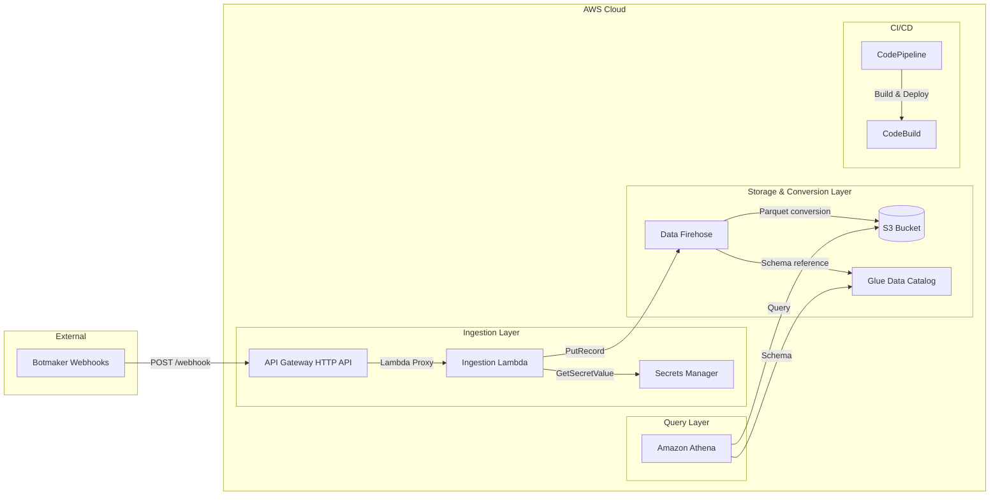

# Botmaker Log Ingestion Pipeline


> ## ⚠️ Nota de ambiente (LEER ANTES DE ASUMIR "dev = prueba")
>
> Este pipeline está desplegado **únicamente en el ambiente `dev`** (cuenta `423623851097`,
> región `us-east-1`): base de datos Athena `botmaker_log_ingestion_dev`, tabla `botmaker_logs`,
> workgroup `botmaker-log-ingestion-dev`. **No existe ni se planea un ambiente `prod`.**
>
> A pesar del sufijo `dev`, este es el ambiente **real y productivo** de los logs de Botmaker:
> **el webhook de Botmaker apunta a este ambiente `dev`**, por lo que recibe el tráfico en vivo.
> No lo trates como datos de prueba descartables.
>
> Nunca se creó un ambiente separado para unirlo al runtime productivo de AgentCore
> (`multimodal_agent_totto-ssFx5aBN5Q`). Cualquier consumidor de estos datos (por ejemplo, el
> dashboard de observabilidad del agente) debe apuntar a los recursos `*-dev` como fuente
> autoritativa, y ese emparejamiento (runtime AgentCore de producción + logs del stack `dev` de
> Botmaker) es **intencional**, no un error de configuración.

A serverless log ingestion pipeline that captures Botmaker webhook events, normalizes them into a stable 16-field schema, converts them to Apache Parquet via Amazon Data Firehose, and stores them in S3 with daily partitions queryable via Amazon Athena.

## Architecture



**Pipeline flow:**

1. Botmaker sends webhook events via HTTP POST to API Gateway
2. Lambda authenticates, validates, and normalizes the payload into a 16-field schema
3. Normalized records are delivered to Firehose via Direct PUT
4. Firehose converts JSON to Parquet (Snappy compression) and writes to S3 with daily partitions
5. Athena queries S3 data using Glue Data Catalog schema with partition projection
6. CI/CD pipeline automates testing, packaging, and multi-environment deployment

---

## Infrastructure: AWS CDK

The infrastructure is defined with **AWS CDK** under `infra/`:

- `infra/app.py` — CDK app entry point (defines `BotmakerLogIngestionDev`, `BotmakerLogIngestionProd`, and the pipeline stack).
- `infra/stacks/ingestion_stack.py` — application stack (S3, Secrets Manager, API Gateway, Lambda, Firehose, Glue, Athena, IAM).
- `infra/stacks/pipeline_stack.py` — CI/CD pipeline stack (CodePipeline + CodeBuild).

The currently deployed stack is **`BotmakerLogIngestionDev`**, created by the CDK app.

> **Note:** A SAM `template.yaml` previously existed at the repo root but was never used to deploy — the live stack has always come from the CDK app. It has been removed. The CI/CD build steps use `cdk synth` to produce the CloudFormation templates deployed by the pipeline.

### Common CDK commands

```bash
pip install -r requirements.txt           # includes aws-cdk-lib
cdk synth BotmakerLogIngestionDev          # synthesize the dev template
cdk diff BotmakerLogIngestionDev           # preview changes against the deployed stack
cdk deploy BotmakerLogIngestionDev         # deploy the dev stack
```

---

## API Reference

Base URL (dev): `https://5g907s87s5.execute-api.us-east-1.amazonaws.com`

All routes require an `Authorization: Bearer <token>` header. The token is stored in Secrets Manager (`botmaker-log-ingestion/dev/webhook-secret`) and compared in constant time. Missing or invalid token returns `401`.

The four routes are defined in `infra/stacks/ingestion_stack.py` and routed internally by `src/handler.py`.

### `POST /webhook` — Ingest an event

Receives the raw Botmaker payload, normalizes it, and delivers it to Firehose.

- Limits: raw payload ≤ 6 MB (`413` if exceeded), decoded body ≤ 1 MB (`400` if exceeded). Base64 bodies supported.
- Validation: parseable JSON (`400` otherwise), must be a JSON object (`400` for arrays/primitives), required fields derivable (`400` if `environment` is missing or `event_type`/`event_id` cannot be derived).
- Delivers to Firehose with retries; on failure returns `503`.

Response `202`:

```json
{
  "status": "accepted",
  "ingestion_id": "15a57745-ddd6-46ad-bf18-ea66df64a03b",
  "event_id": "err_001",
  "event_type": "EXTERNAL_API_ERROR",
  "fields_extracted": {
    "conversation_id": "conv_001", "message_id": "wamid.001", "user_id": "user_001",
    "order_form_id": "of_001", "source_channel": "whatsapp", "source_bot": "agentcore",
    "severity": "ERROR", "error_code": "CATALOG_001"
  }
}
```

### `GET /webhook/health` — Health check

Response `200`:

```json
{ "status": "healthy", "environment": "dev", "firehose_stream": "botmaker-log-ingestion-dev" }
```

### `GET /webhook/{ingestion_id}` — Look up one event by id

1. Checks CloudWatch Logs for `FIREHOSE_ACCEPTED` (confirms processing, 10-minute window).
2. Queries Athena for the stored Parquet record.

Responses: `200 stored` (in S3), `200 pending` (accepted but still in the Firehose buffer, ~5 min), `404 not_found`, `400` if the id is shorter than 10 characters.

### `GET /webhook?date=YYYY-MM-DD` — List events by date

Queries Athena filtering by `ingestion_date`. Optional filters: `event_type`, `conversation_id`, `source_channel`, `limit` (max 100).

Response `200`:

```json
{ "status": "success", "date": "2026-08-05", "filters": {}, "count": 4, "records": [ ... ] }
```

If the Athena query fails, returns `503`.

---

## Stored Record Schema (16 fields + partition)

Each record is stored as Parquet. All fields come back as strings from Athena (including `schema_version`, whose Glue type is `int`).

| # | Field | Type (Glue) | Required | Source from payload |
|---|-------|-------------|----------|---------------------|
| 1 | `ingestion_id` | string | yes | UUID v4 generated at ingestion (unique key) |
| 2 | `event_id` | string | yes | `eventId` → `errorId` → `linkId` → `messageId` → `conversation.messageId` → UUID v4 |
| 3 | `request_id` | string | no | API Gateway request ID (correlation) |
| 4 | `received_at` | string | yes | UTC receive timestamp (`YYYY-MM-DDTHH:MM:SS.mmmZ`) |
| 5 | `schema_version` | int | yes | `SCHEMA_VERSION` constant (currently `1`) |
| 6 | `environment` | string | yes | `dev` (from Lambda config) |
| 7 | `event_type` | string | yes | `eventType` → `error.type` → `type` → `PAYMENT_LINK_EVENT` (if `paymentLink`) → `ORDER_EVENT` (if `orders`) → `UNKNOWN` |
| 8 | `conversation_id` | string | no | `conversation.conversationId` |
| 9 | `message_id` | string | no | `messageId` → `conversation.messageId` |
| 10 | `user_id` | string | no | `conversation.userId` |
| 11 | `order_form_id` | string | no | `orderForm.id` → `context.orderFormId` |
| 12 | `source_channel` | string | no | `source.channel` |
| 13 | `source_bot` | string | no | `source.bot` |
| 14 | `severity` | string | no | `error.severity` |
| 15 | `error_code` | string | no | `error.code` |
| 16 | `raw_event_json` | string | yes | Full original payload serialized as JSON (lossless) |
| — | `ingestion_date` | string | yes (partition) | Firehose arrival date, `America/Bogota` timezone |

Notes:

- Fields 8–15 are optional: if the payload does not carry them, they are stored as `null`.
- `raw_event_json` preserves 100% of the payload; query any unmapped field ad-hoc with `json_extract_scalar(raw_event_json, '$.path.to.field')`.

### Event types observed in real data

`PAYMENT_LINK_EVENT`, `EXTERNAL_API_ERROR`, `INTERNAL_ERROR`, `MESSAGE_RECEIVED`. Smoke-test events use `event_type = 'PIPELINE_SMOKE_TEST'` and should be excluded from analytics.

### Raw input payloads (examples)

**Error event (`EXTERNAL_API_ERROR`)**

```json
{
  "errorId": "err_001",
  "timestamp": "2026-08-05T20:30:00.000Z",
  "source": { "channel": "whatsapp", "bot": "agentcore" },
  "conversation": { "conversationId": "conv_001", "userId": "user_001", "phone": "********1234", "messageId": "wamid.001" },
  "error": { "type": "EXTERNAL_API_ERROR", "code": "CATALOG_001", "message": "...", "severity": "ERROR" },
  "context": { "operation": "getProductAvailability", "orderFormId": "of_001" }
}
```

**Payment link (`PAYMENT_LINK_EVENT`)**

```json
{
  "linkId": "plink_001",
  "timestamp": "2026-08-05T20:35:00.000Z",
  "store": { "account": "tottoco", "domain": "https://co.totto.com" },
  "orderForm": { "id": "of_002" },
  "paymentLink": { "status": "ACTIVE", "url": "https://.../payment/001" },
  "conversation": { "conversationId": "conv_002", "userId": "user_002", "messageId": "wamid.002" },
  "orders": [ { "orderId": "243468274-01", "total": 25000000 } ],
  "source": { "channel": "whatsapp", "bot": "agentcore" }
}
```

**Order event (`ORDER_EVENT`)** — detected by the presence of the `orders` key when no more specific `event_type` is present.

---

## AWS CodeConnections GitHub Setup

Before deploying the CI/CD pipeline, you must create an AWS CodeConnections connection to your GitHub repository.

### Steps

1. **Create the connection** — Open the AWS Console and navigate to **Developer Tools > Settings > Connections**. Click **Create connection**, select **GitHub** as the provider, and give it a name (e.g., `botmaker-log-ingestion-github`).

2. **Authorize the GitHub account** — Follow the prompts to install the AWS Connector for GitHub app on your GitHub account or organization. Select the repository you want to connect.

3. **Confirm the connection status** — After authorization, verify the connection status shows **Available** in the Connections list.

4. **Retrieve the Connection ARN** — Copy the Connection ARN from the connection details page. It will look like:
   ```
   arn:aws:codeconnections:<region>:<account-id>:connection/<connection-id>
   ```
   You will need this ARN when deploying the CI/CD pipeline stack.

> **Note:** AWS CodeConnections replaces the deprecated CodeStar Connections. The pipeline does NOT use GitHub personal access tokens — it relies exclusively on CodeConnections for source access.

---

## Initial Pipeline Deployment

### Prerequisites

- **AWS CLI** v2 — configured with appropriate credentials
- **AWS CDK** v2 — for synthesizing and deploying the stacks
- **Python 3.12** — Lambda runtime version

### Deploy the CI/CD Pipeline Stack

The pipeline is a CDK stack. Pass the CodeConnections ARN and repository details via CDK context:

```bash
cdk deploy BotmakerLogIngestionPipeline \
  --context connectionArn=arn:aws:codeconnections:<region>:<account-id>:connection/<connection-id> \
  --context repositoryOwner=your-org \
  --context repositoryName=botmaker-log-ingestion \
  --context branchName=main
```

### Verify Deployment

1. Open the **AWS CodePipeline** console
2. Find the pipeline named `botmaker-log-ingestion`
3. Confirm the Source stage connects successfully and the pipeline runs through all stages

The pipeline has 8 stages: Source → ValidateAndTest → Package → DeployDev → IntegrationTests → ManualApproval → DeployProd → SmokeTestProd.

---

## Local Development

### Setup

```bash
python -m venv venv
source venv/bin/activate  # or venv\Scripts\activate on Windows
pip install -r requirements-dev.txt
```

### Run Tests

```bash
# Unit + Property tests
pytest tests/unit/ tests/properties/ --cov=src --cov-report=xml -v

# Schema validation tests
pytest tests/schema/ -v

# All local tests
pytest tests/unit/ tests/properties/ tests/schema/ -v
```

> **Note:** The Lambda runtime is Python 3.12. Running the tests on a different version (e.g. 3.14) may cause mocking failures in `tests/unit/test_handler.py`.

### Project Structure

```
src/
├── handler.py          # Lambda entry point and routing
├── auth.py             # Token validation, secret caching
├── normalizer.py       # Field extraction, schema normalization
├── firehose_client.py  # PutRecord wrapper with error handling
├── query_handler.py    # GET endpoints (health, lookup by id, list)
├── logger.py           # Structured JSON logging with redaction
└── config.py           # Environment-based configuration

infra/
├── app.py              # CDK app entry point
└── stacks/
    ├── ingestion_stack.py  # Application resources
    └── pipeline_stack.py   # CI/CD pipeline

tests/
├── unit/               # Unit tests (pytest + mocks)
├── properties/         # Property-based tests (Hypothesis)
├── schema/             # Parquet round-trip tests (PyArrow)
├── integration/        # Integration tests (deployed dev stack)
└── smoke/              # Smoke tests (deployed prod stack)
```

---

## Configuration Parameters

Configurable parameters for the ingestion stack (`IngestionStack` constructor in `infra/stacks/ingestion_stack.py`):

| Parameter | Type | Default | Description |
|-----------|------|---------|-------------|
| environment | str | dev | Deployment environment: `dev` or `prod` |
| firehose_buffer_interval_seconds | int | 300 | Firehose buffer interval in seconds (min 60, max 900) |
| firehose_buffer_size_mb | int | 64 | Firehose buffer size in MB (min 64 required with format conversion enabled) |
| partition_projection_start_date | str | 2026-01-01 | Start date for Athena partition projection (yyyy-MM-dd) |
| parquet_compression | str | SNAPPY | Parquet compression algorithm: `SNAPPY`, `GZIP`, or `UNCOMPRESSED` |
| enable_athena_workgroup | bool | True | Whether to create the Athena WorkGroup |
| log_payload | bool | False | Whether the Lambda logs payload metadata |

---

## Athena Query Examples

The data is stored in the Glue database `botmaker_log_ingestion_dev` with a table named `botmaker_logs`. Below are ready-to-copy query examples.

### Filter by Date

```sql
SELECT *
FROM "botmaker_log_ingestion_dev"."botmaker_logs"
WHERE ingestion_date = '2026-08-03'
LIMIT 100;
```

### Events by Type

```sql
SELECT event_type, count(*) AS total
FROM "botmaker_log_ingestion_dev"."botmaker_logs"
WHERE ingestion_date BETWEEN '2026-08-01' AND '2026-08-03'
GROUP BY event_type
ORDER BY total DESC;
```

### Extract Nested Field with json_extract_scalar

```sql
SELECT
  event_id,
  json_extract_scalar(raw_event_json, '$.error.message') AS error_message
FROM "botmaker_log_ingestion_dev"."botmaker_logs"
WHERE ingestion_date = '2026-08-03'
  AND severity = 'ERROR';
```

### Exclude Smoke Tests

```sql
SELECT *
FROM "botmaker_log_ingestion_dev"."botmaker_logs"
WHERE ingestion_date = '2026-08-03'
  AND event_type != 'PIPELINE_SMOKE_TEST'
LIMIT 100;
```

### Conversation by ID

```sql
SELECT received_at, event_id, event_type, message_id, raw_event_json
FROM "botmaker_log_ingestion_dev"."botmaker_logs"
WHERE ingestion_date BETWEEN '2026-08-01' AND '2026-08-03'
  AND conversation_id = 'conv_123456'
ORDER BY received_at;
```

---

## Important Notes

- **Always filter by `ingestion_date`** to reduce the amount of data scanned and keep query costs low. Partition projection enables instant partition resolution without a Glue Crawler.

- **`ingestion_date` is based on Firehose arrival time** using the `America/Bogota` (UTC-5) timezone, not the event's original timestamp. This means an event generated at 23:30 UTC may land in the next day's partition in Bogota time.

- **`raw_event_json` preserves the complete original JSON** — use `json_extract_scalar` or `json_extract` to query nested fields ad-hoc without schema changes.

- **PyArrow is a dev-only dependency** — it is used for Parquet schema validation tests but is NOT deployed to the Lambda runtime. Firehose handles Parquet conversion natively using the Glue schema.

- **Smoke test events** with `event_type = 'PIPELINE_SMOKE_TEST'` are injected after each production deployment. Exclude them from analytics queries.
